# CyberRoot

**An isolated workspace for AI security agents. Bring your own models; add Kali, Strix or Shannon only when you need them.**

Run OpenCode inside a separate Linux VM or a configured SSH target, switch models and sessions from the terminal, and copy small deliverables back to your machine.

[Quick start](#quick-start) · [Examples](#three-practical-workflows) · [Optional tools](#optional-tools) · [Agent setup](AGENT-INSTALL.md) · [Contributing](CONTRIBUTING.md) · [Changelog](CHANGELOG.md)



*25-second scripted preview — no live scan, credentials or model results.* [Terminal cast](docs/demo.cast); optionally play it with `asciinema play docs/demo.cast`. No player package is required to use CyberRoot.

**Early preview:** macOS Apple Silicon is the exercised host workflow. Linux/WSL2 adapters have offline tests; a real Linux/WSL2 host setup has not been validated. See [validation limits](#status-and-validation).

## Who is it for?

- Researchers who want a separate workspace for AI-assisted code and APK review.
- Developers who want their own API models and optional security tools in one terminal workflow.
- Coding agents that need explicit, machine-readable installation steps.

CyberRoot coordinates existing agents and tools. It does not provide its own vulnerability-discovery engine or guarantee that a model's finding is correct. Test only systems you own or are explicitly authorized to assess.

## Quick start

Host prerequisites: Bash, Git, Perl, Python 3, curl, OpenSSH and standard Unix tools. Local VMs require [Lima 2.0+](https://lima-vm.io); Linux/Intel hosts also need QEMU. `fzf` is optional; menus work without it. SSH targets do not need local Lima.

```bash
git clone https://github.com/agtt/cyberroot.git ~/cyberroot
cd ~/cyberroot
./ailab doctor        # read-only checks; never boots a target or calls a model
./ailab setup         # choose local VM/SSH and model; optional tools start unselected
./ailab               # interactive interface
```

The wizard saves target/model preferences, shows the proposed commands and asks before provisioning. Decline that last step to configure only. You can also use `./ailab up` for base setup directly. A first interactive launch without a saved default model opens the wizard automatically.

For a convenient `cyber` command, add `alias cyber="$HOME/cyberroot/ailab"` to your `~/.zshrc` or `~/.bashrc`, then reload that file. Agents should call `./ailab` directly; aliases are unnecessary.

**Nothing optional is installed by base setup:** Kali, Strix, Shannon, their guest Docker/Node/Bun dependencies and quota network checks all require an explicit choice. Local templates create ignored `models.txt` and `opencode.jsonc` files on first use; existing settings are kept.

## What you get

| Feature | Behavior |
|---|---|
| Isolated OpenCode workspace | Separate Linux guest, no host folder sharing, unprivileged agent |
| Your own models | Configured OpenAI-compatible providers and model shortcuts |
| Sessions and live output | Pick/resume sessions, stream output and retain local logs |
| Bounded continuation | Continue unfinished tool rounds; default limit 12, `0` explicitly removes it |
| Model fallback | Switch configured models on provider limit/availability errors |
| Optional integrations | Kali CLI, Strix and Shannon, independently selected |
| Diagnostics | `doctor` checks dependencies, runtime, configuration and tool state |
| Agent installation plans | JSON argument arrays in dependency order; no selection means no installs |
| Small deliverables | Copy files up to three levels deep and under 10 MB; `pull all` is explicit |
| Optional quota display | Supported account APIs show balances; unsupported quotas remain unknown |

Strix/Shannon use their own execution loops, worker images, reports and exit codes. CyberRoot's OpenCode fallback/continuation loop does not wrap those upstream engines.

## Three practical workflows

The commands below use the optional `cyber` alias. All project paths refer to the **guest**, not your host filesystem. Get code into the guest with `cyber sh` and an authorized repository clone or explicit file copy.

### 1. Source code review

```bash
cyber sh
# Inside the guest: clone your authorized repository into ~/work/project, then exit.
cyber "Review ~/work/project for security issues using static analysis only. Save evidence and findings to ~/work/project/REPORT.md."
cyber pull
```

Small deliverables appear under the checkout's `out/work/`. Treat model findings as candidates to verify.

### 2. Static APK review

```bash
cyber sh -c 'mkdir -p ~/work/mobile && cat > ~/work/mobile/app.apk' < app.apk
cyber "Inspect ~/work/mobile/app.apk statically. Reuse installed JADX/apktool, do not run the app, and save ~/work/mobile/REPORT.md."
cyber pull
```

The base guest includes APK analysis utilities; the optional Kali integration is not required. Large intermediate/decompiled trees stay in the guest unless explicitly pulled.

### 3. Authorized web assessment with an optional tool

After explicitly installing Strix and its guest rootless engine, choose your configured API model:

```bash
cyber strix --model research -- --target https://your-authorized-app.example
# Or, after choosing Shannon instead:
cyber shannon --model research -- start -u https://your-authorized-app.example -r ./project
```

These commands can actively test the supplied target and incur provider costs. Installing a tool does not run a scan or authorize testing any target.

## Optional tools

| Component | Purpose | Explicit install |
|---|---|---|
| `engine` | Guest rootless Docker shared by the integrations | `cyber tools install engine` |
| `kali` | Compact Kali image with selected CLI utilities | `cyber tools install kali` |
| `strix` | Pinned Strix CLI | `cyber tools install strix` |
| `shannon` | Pinned Shannon CLI plus its Node/Bun prerequisites | `cyber tools install shannon` |

Install **only** what you choose. For example, a Strix setup needs the engine and Strix, not Kali or Shannon:

```bash
cyber tools plan strix --json    # inspect first; no downloads or target startup
cyber tools install engine      # asks for confirmation
cyber tools install strix       # asks for confirmation
cyber strix --version           # no model key or running Docker needed
```

Agents can use the plan's `commands` arrays with `--yes` after the user authorizes that integration. `cyber tools plan --json` returns the catalog with an empty command list. See [AGENT-INSTALL.md](AGENT-INSTALL.md) for base setup, prerequisites, credentials and cleanup.

```bash
cyber kali -- nmap -sT -h                         # offline by default
cyber kali --network -- curl https://example.com # explicitly authorized network work only
cyber tools                                      # availability; stopped targets stay stopped
```

Kali has a read-only root, dropped capabilities, a 2 GiB memory limit and no network by default. Its `/work` is the guest's `~/work`; the computer's Docker socket is never shared. Strix/Shannon manage their own worker containers inside the outer guest boundary. Packages, worker images and caches can occupy hundreds of MB or more. Their worker images may download on first real use.

Upstream distributions are downloaded separately under their own licenses: [Strix](https://github.com/usestrix/strix) (Apache-2.0), [Shannon](https://github.com/KeygraphHQ/shannon) (AGPL-3.0), [Kali](https://www.kali.org/docs/containers/official-kalilinux-docker-images/). The guest engine uses [rootless Docker](https://docs.docker.com/engine/security/rootless/).

## Models and credentials

Use `/model` to select a shortcut, `/add` to browse configured provider catalogs, or `cyber add research provider/model-id` to add a model without a build. A new OpenAI-compatible provider can be added by `cyber setup` or `cyber config`; the wizard preserves existing settings and serializes JSONC as formatted JSON.

Enter a key privately with `cyber key <provider>`, then run `cyber sync`. Do not put credentials in command arguments, reports or commits. See `opencode.example.jsonc` for the provider structure.

- **OpenCode free presets:** no API key required; availability depends on the provider.
- **Your API providers:** custom endpoint, upstream model ID and key.
- **Host Claude entries:** `claude/<model>` deliberately opens Claude Code **outside the sandbox** in `CYBER_HOST_DIR`/`hostdir`/the current directory. They are marked `host`.

Strix/Shannon reuse a configured **HTTPS OpenAI-compatible API provider**. Keys go through the child environment, not argv or generated model files. Shannon gets temporary Chat Completions model metadata. OpenCode free models and host Claude sessions have no transferable API credentials. Tool-calling support and account access depend on your chosen model.

Quota checks are optional and off by default. `/quota` checks once; `/quota on` enables two-minute cached checks; `/quota off` disables them. The current reader supports the [OpenRouter account API](https://openrouter.ai/docs/api/api-reference/api-keys/get-current-key). Other providers remain usable and display `remaining unknown`. Account/key balances are shared across models using that provider/key; a local retry cooldown is not a provider quota-reset timer. Cached data shows its age. No model call is made for a quota check.

## Terminal shortcuts

| Command | Purpose |
|---|---|
| `/setup`, `/doctor` | Guided setup and read-only diagnostics |
| `/model`, `/models` | Select/list model shortcuts |
| `/s`, `/recent`, `/1`–`/9`, `/new` | Select, resume or start sessions |
| `/add`, `/rm` | Manage model shortcuts |
| `/fallback a b`, `/rounds N` | Fallback order and continuation limit |
| `/tools`, `/tools plan <name> --json` | Optional tools and offline install plans |
| `/kali`, `/strix`, `/shannon` | Run an installed optional integration |
| `/quota`, `/quota on`, `/quota off` | Optional balance checks |
| `/pull`, `/out`, `/log` | Deliverables, output folder and latest log |
| `/status`, `/clean`, `/down` | Runtime, confirmed cleanup and local VM shutdown |
| `/sh`, `!command` | Guest shell or one guest command |
| `/claude` | Host Claude Code; outside the sandbox |

Typing `/` lists matching commands under the prompt as you type: `↑`/`↓` pick, `Tab` completes, `Enter` runs the highlighted command, `Esc` hides the list. `Ctrl-C` clears the line and, pressed twice on an empty line, exits; `Ctrl-D` exits; `Ctrl-Z` suspends (`fg` resumes). Set `CYBER_PLAIN_INPUT=1` for the plain readline prompt.

`/theme` (or `cyber theme`) switches colours: `root` keeps standard terminal colours with a green logo (default), `matrix` is all green phosphor, `mono` is plain text.

### Recent CVEs

`cyber cve` lists CVEs published in the last 3 days from NVD, newest first, and marks those in CISA's Known Exploited Vulnerabilities catalog with `KEV`. Only these two public feeds are read; responses are cached under `out/.cve` and a stale copy is used when a feed is unreachable.

```bash
cyber cve                      # last 3 days
cyber cve wordpress --days 30  # keyword search (all words must match)
cyber cve --severity critical  # that level and above
cyber cve --kev --days 30      # CISA known-exploited additions
cyber cve CVE-2024-3400        # one CVE: scores, CWE, exploitation, references
cyber cve --json               # machine-readable, for agents
```

An NVD API key is optional (`NVD_API_KEY` or `.secrets/nvd-api-key`); it only raises the rate limit.

Without the interface: `cyber "task"`, `cyber research "task"`, `cyber -c "continue"`, or pipe input with `cat notes.txt | cyber "summarize this"`. `cyber help` lists commands, `cyber sessions` lists sessions and `cyber logs [N | -f]` lists, opens or follows run logs. `cyber --version` prints the CLI version without starting a guest.

## Diagnostics and remote targets

```bash
cyber doctor             # local prerequisites, configuration and current target state
cyber doctor --json      # machine-readable; no secrets or provider authentication
cyber doctor --live      # also perform read-only SSH checks for a configured remote target
cyber target vps my-ssh-host
cyber up
cyber target local
```

Default diagnostics never start a VM, install packages, contact a model or connect to a remote SSH target. A running local guest can be checked read-only for firewall/tool state. Keys are checked for presence, not validity; no credential value is displayed. A stopped target leaves guest checks unknown rather than silently starting it.

On Windows use WSL2's Linux shell. Without usable nested QEMU/KVM, prefer an SSH target. A WSL2 distro itself is not the agent sandbox. `/out` uses `wslview` if present, or prints the path on a headless shell.

## Isolation and disk use

The local Lima guest uses `mounts: []`, `plain: true` and firewall rules blocking host/private-network destinations, with the agent running without sudo. VPS rules restrict the agent's private-network egress. Internet is open; traffic uses your/VPS IP. These restrictions do not apply to explicit host Claude sessions.

Synced API keys are readable by the guest agent; use scoped/low-limit keys. Anything readable inside the guest can be sent to the internet. Isolation does not prevent prompt injection or make model findings reliable.

The VM has 6 CPUs, 10 GB RAM and a 30 GB sparse disk, with configurable idle shutdown (default 60 minutes). `cyber down` stops it; installed optional tools remain available. Persistent optional tool services can keep the guest active. Logs older than a day are compressed. Failed pulls preserve the old sync timestamp for retry. `cyber clean` deletes only selected, confirmed work/log data and trims guest free space; it does not uninstall optional package/engine stores. No global Docker prune is used.

## Status and validation

This is an MIT-licensed **early preview**, not an independently audited security boundary or a promise of verified vulnerabilities. Offline checks cover configuration preservation, explicit install plans, model routing, diagnostics, command arguments and default isolation settings. Real Linux arm64 Strix/Shannon install and help/version checks passed. A temporary official Kali image passed read-only root, zero-capability and offline-network checks; test downloads/images were removed.

Full rootless-engine installation, the custom Kali image build and complete upstream worker/paid-model pentest runs remain unverified end to end. macOS Apple Silicon is the exercised host; Linux/WSL2 host adapters have offline tests only.

See [CONTRIBUTING.md](CONTRIBUTING.md) for focused checks, [AGENT-INSTALL.md](AGENT-INSTALL.md) for agent installation and [CHANGELOG.md](CHANGELOG.md) for preview releases. The demo is generated locally from scripted fixtures with `python3 -B scripts/render-demo.py`; no live findings or credentials are recorded.
